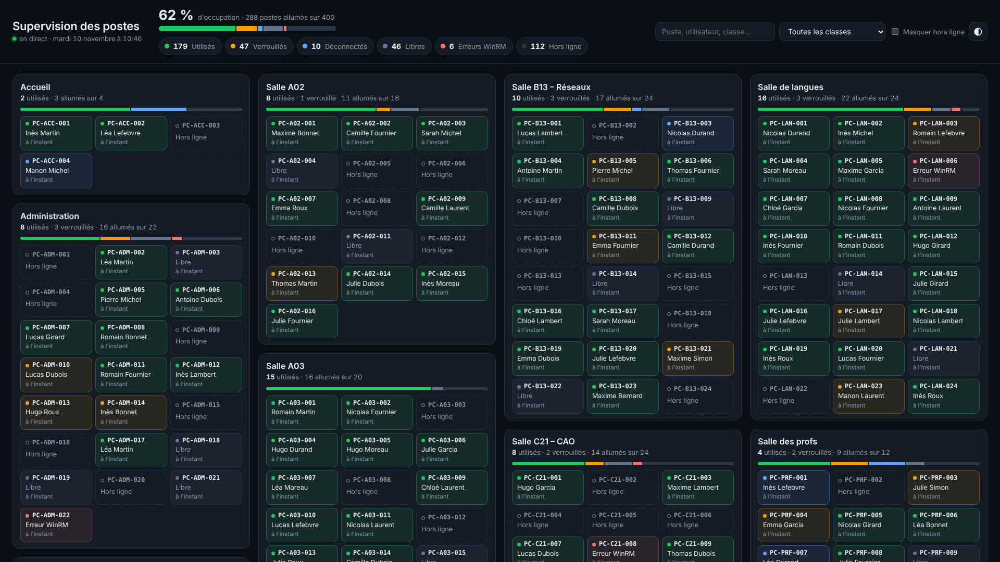

# Supervision des postes

Écran de supervision en direct du parc Windows : pour chaque poste du domaine, on voit
s'il est allumé, utilisé, verrouillé ou libre, et par qui.

**Rien n'est installé sur les postes.** Un serveur du domaine les interroge par WinRM.



La page suit le thème clair ou sombre du système ; le bouton en haut à droite permet de le forcer ([thème clair](docs/ecran-clair.png)).

## Fonctionnement

```
 Active Directory ──(liste des postes, noms des utilisateurs)──┐
                                                               ▼
 400 postes ◄──WinRM 5985 (CIM)── Collecter-Postes.ps1 ──HTTP POST──► supervision.py ──SSE──► navigateurs
                                  (PowerShell 7, toutes les 30 s)     (Python, SQLite)          (écran mural)
```

| Élément | Rôle |
|---|---|
| `collecteur/Collecter-Postes.ps1` | Lit les ordinateurs des OU choisies dans l'AD, interroge chaque poste en parallèle (64 à la fois par défaut), complète avec le nom complet et le service de l'utilisateur, puis envoie le tout au serveur. |
| `serveur/supervision.py` | Reçoit les relevés, garde l'état et l'historique dans SQLite et pousse les changements en direct vers les navigateurs. Bibliothèque standard Python uniquement : aucun paquet à installer. |
| `serveur/statique/` | La page web : une carte par classe avec sa jauge d'occupation, une tuile par poste, taux d'occupation global, filtres par état, recherche, panneau de détail avec historique. |
| `outils/simulateur.py` | Envoie un faux parc de 400 postes pour tester l'écran sans AD. |

### États d'un poste

| État | Comment il est déterminé |
|---|---|
| 🟢 **Utilisé** | Un utilisateur est connecté à la console (`Win32_ComputerSystem.UserName`) et `LogonUI.exe` ne tourne pas. |
| 🟠 **Verrouillé** | Un utilisateur est connecté et `LogonUI.exe` tourne (écran de verrouillage). |
| 🔵 **Session déconnectée** | Personne à la console, mais un `explorer.exe` tourne : session en arrière-plan (changement d'utilisateur) ou bureau à distance. |
| ⚪ **Libre** | Allumé, personne de connecté. |
| 🔴 **Injoignable WinRM** | Le port 5985 répond mais la requête échoue (accès refusé, WinRM mal configuré…). Le message d'erreur est dans le panneau de détail. |
| ⚫ **Hors ligne** | Le port 5985 ne répond pas : poste éteint, hors réseau ou pare-feu. |

Un poste dont le collecteur n'a plus donné de nouvelles depuis 5 minutes est grisé en pointillés.
L'inactivité (« inactif 12 min ») vient de `quser` et ne s'affiche qu'à partir de 5 minutes.

## Prérequis sur les postes (par GPO)

Une seule GPO liée à l'OU des postes suffit.

1. **Activer WinRM**
   `Configuration ordinateur > Stratégies > Modèles d'administration > Composants Windows > Gestion à distance de Windows (WinRM) > Service WinRM`
   - *Autoriser la gestion à distance du serveur via WinRM* : **Activé**, filtre IPv4 = l'adresse du serveur de supervision.
   - `Configuration ordinateur > Préférences > Paramètres du Panneau de configuration > Services` : service **WinRM** en démarrage *Automatique*.
2. **Pare-feu** : règle entrante TCP **5985** autorisée uniquement depuis l'IP du serveur de supervision.
3. **Droits du compte de service** : le compte qui exécute le collecteur (idéalement un gMSA, par ex. `ESK\gmsa-supervision$`) doit être **administrateur local** des postes
   (`Préférences > Paramètres du Panneau de configuration > Utilisateurs et groupes locaux`).
   C'est nécessaire pour lire le propriétaire des processus d'un autre utilisateur ; un compte non administrateur verra les postes en « Injoignable WinRM ».
4. *Facultatif, pour le temps d'inactivité* : `quser /server:` passe par RPC. Il faut
   `HKLM\SYSTEM\CurrentControlSet\Control\Terminal Server\AllowRemoteRPC = 1` (DWORD, via les préférences de registre)
   et la règle de pare-feu *Gestion à distance des services* depuis le serveur. Sans cela, mettre `"Quser": false` dans la configuration : le reste fonctionne.

Vérification depuis le serveur, avec le compte de service :

```powershell
Test-WSMan PC-XXX
Get-CimInstance -ComputerName PC-XXX -ClassName Win32_ComputerSystem | Select-Object UserName
```

## Installation sur le serveur de supervision

Un serveur Windows membre du domaine (une VM modeste suffit pour 400 postes) avec :

- **PowerShell 7** et le module **ActiveDirectory** (RSAT : `Install-WindowsFeature RSAT-AD-PowerShell`) ;
- **Python 3.9 ou plus récent** (https://www.python.org, aucun paquet supplémentaire).

### 1. Le serveur web

```powershell
# Un secret partagé entre le collecteur et le serveur
$token = [Convert]::ToBase64String([Security.Cryptography.RandomNumberGenerator]::GetBytes(32))

python C:\Supervision\serveur\supervision.py --port 8080 --token $token --base C:\Supervision\supervision.db
```

Ouvrir ensuite `http://srv-supervision:8080/` sur l'écran mural (touche F11 pour le plein écran).

Options : `--perime 300` (secondes avant de griser un poste muet), `--historique-jours 90` (conservation de l'historique).
Le token peut aussi être passé par la variable d'environnement `SUPERVISION_TOKEN`.

### 2. Le collecteur

```powershell
Copy-Item C:\Supervision\collecteur\config.exemple.json C:\Supervision\collecteur\config.json
# Éditer config.json : ServeurUrl, Token, OUs à superviser

# Test : un seul passage, résultat dans la console, rien n'est envoyé
pwsh C:\Supervision\collecteur\Collecter-Postes.ps1 -UneFois -Afficher
```

| Paramètre | Défaut | Rôle |
|---|---|---|
| `OUs` | | Liste des OU contenant les postes (DN complets). |
| `FiltreAD` | `Enabled -eq 'True'` | Filtre `Get-ADComputer`. |
| `RegexClasse` | vide | Tire la classe du nom du poste, avec un groupe nommé `classe`. Ex. `^PC-(?<classe>[A-Z]\\d+)-` : `PC-B12-07` va dans la classe `B12`. Vide : la classe est l'OU qui contient le poste. |
| `NomsClasses` | `{}` | Noms affichés, ex. `{ "B12": "Salle B12 – Informatique" }`. |
| `IntervalleSecondes` | 30 | Délai entre deux passages. |
| `RafraichirADMinutes` | 15 | Fréquence de relecture de la liste des postes dans l'AD. |
| `Parallelisme` | 64 | Postes interrogés en même temps. |
| `DelaiSecondes` | 5 | Délai d'attente par poste. |
| `Quser` | `true` | Lire le temps d'inactivité. |

### 3. Démarrage automatique

Deux tâches planifiées « Au démarrage du système », exécutées même sans session ouverte :

```powershell
# Serveur web (compte SYSTEM suffit)
$a = New-ScheduledTaskAction -Execute 'python.exe' `
     -Argument "C:\Supervision\serveur\supervision.py --port 8080 --base C:\Supervision\supervision.db" `
     -WorkingDirectory 'C:\Supervision\serveur'
Register-ScheduledTask 'Supervision - serveur' -Action $a -Trigger (New-ScheduledTaskTrigger -AtStartup) `
     -User SYSTEM -RunLevel Highest
# Définir SUPERVISION_TOKEN comme variable d'environnement système plutôt que dans la ligne de commande.

# Collecteur, sous le gMSA
$a = New-ScheduledTaskAction -Execute 'pwsh.exe' `
     -Argument "-NoProfile -File C:\Supervision\collecteur\Collecter-Postes.ps1"
$p = New-ScheduledTaskPrincipal -UserId 'ESK\gmsa-supervision$' -LogonType Password
Register-ScheduledTask 'Supervision - collecteur' -Action $a -Trigger (New-ScheduledTaskTrigger -AtStartup) -Principal $p
```

Penser à retirer la limite « Arrêter la tâche si elle s'exécute plus de 3 jours » dans les paramètres des deux tâches.

## Sécurité et confidentialité

- Le collecteur s'authentifie auprès du serveur avec le token (en-tête `X-Token`). La page en lecture n'a pas d'authentification : limiter le port 8080 au réseau d'administration ou placer le serveur derrière IIS/ARR avec HTTPS et authentification Windows.
- `config.json` contient le token : ne pas le versionner (il est dans `.gitignore`) et restreindre ses droits NTFS au compte de service.
- L'outil affiche qui est connecté à quel poste et garde un historique : informer les salariés et les représentants du personnel, et l'inscrire au registre des traitements (RGPD). La durée de conservation se règle avec `--historique-jours`.

## Tester sans Active Directory

```bash
python serveur/supervision.py --port 8080 --token test
python outils/simulateur.py --url http://localhost:8080 --token test
python -m unittest discover -s tests
```
